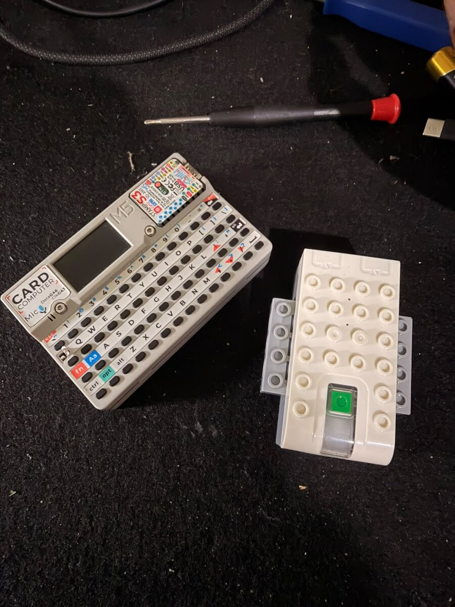
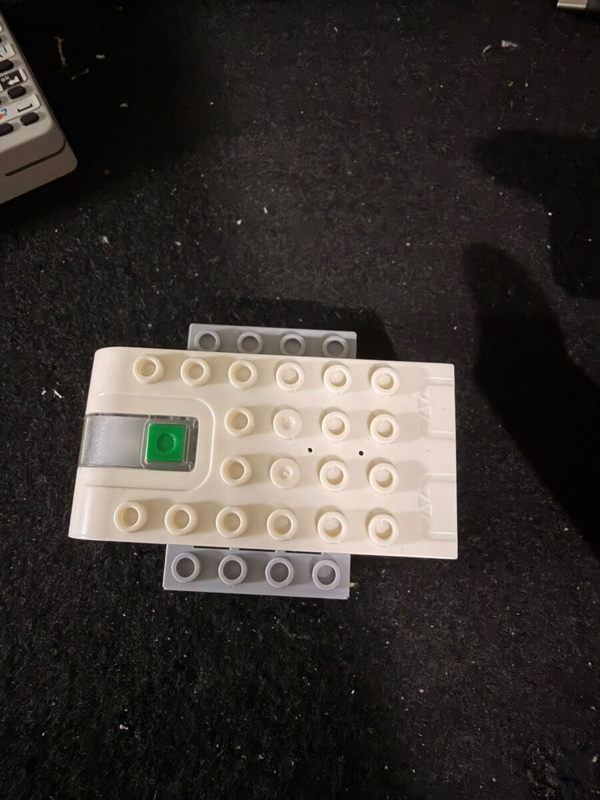
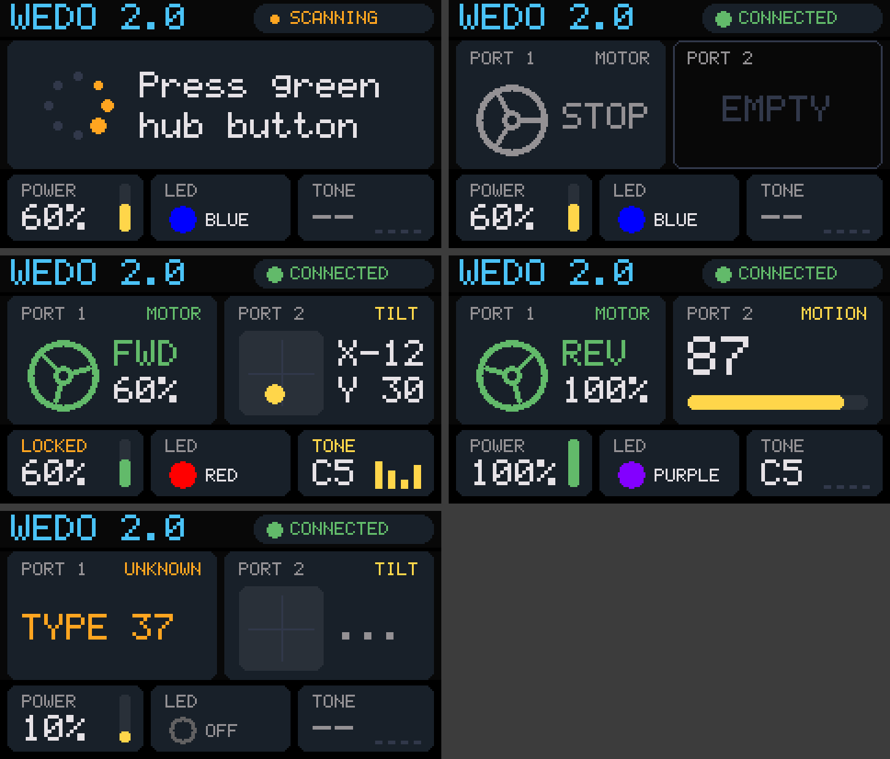

# WeDo 2.0 controller

Control a LEGO WeDo 2.0 Smart Hub over Bluetooth LE without the LEGO app:

- `cardputer/` - firmware that turns an M5Stack Cardputer into a handheld controller
- `wedo2.py` - a small command-line tool for a Linux PC

<p>
  
  
</p>

The controller screen, rendered on a PC from the firmware's own drawing code:



## Cardputer controller

For the Cardputer original and v1.1 (StampS3, ESP32-S3). Built with ESP-IDF
through PlatformIO, NimBLE as the BLE host.

Switch the hub on (green button). The Cardputer scans, connects by itself and
reconnects after a lost link.

| Key | Action |
|---|---|
| `;` / `.` (up / down arrows) | Run every attached motor forward / reverse while held |
| `F` / `B` | Keep running forward / backward; same key again stops |
| `,` / `/` (left / right arrows) | Motor power down / up, 10 to 100 |
| `1` to `9`, `0` | Hub LED colour; `0` switches it off |
| `Q W E R T Y U I` | Notes C5 to C6 on the Cardputer speaker while held |
| `-` / `=` | Speaker volume down / up |
| `Space` | Stop motors and sound |

The screen shows the link state, one card per hub port (motor with a spinning
rotor, tilt sensor with a level bubble, motion sensor with a gauge) and the
power, LED and tone settings.

### Build and flash

```
cd cardputer
pio run -t upload
```

The board is expected on `/dev/ttyACM0` (set in `platformio.ini`).

After adding or removing a source file, delete `.pio/build/cardputer_dev`
before building.

On Linux, opening the serial port with a normal monitor resets the board.
`tools/serial_peek.py /dev/ttyACM0 20` reads the log without doing that.

### Checks that run on a PC

```
cd cardputer
cc -std=c11 -Wall -Wextra -Wpedantic -Werror -I components/app_wedo/include test/host/test_wedo_proto.c components/app_wedo/wedo_proto.c -o /tmp/test_wedo && /tmp/test_wedo
sh test/host/render_preview.sh /tmp/wedo-preview
```

The first checks the command bytes. The second draws the screen into PPM
images with the same drawing code the firmware uses.

## PC tool

```
python3 -m venv .venv && .venv/bin/pip install bleak
.venv/bin/python wedo2.py scan
.venv/bin/python wedo2.py led ff0000
.venv/bin/python wedo2.py motor 1 60 2
.venv/bin/python wedo2.py monitor
```

Press the hub's green button right before each command: it only advertises
for a short time.

## Status and known limits

Tested with one hub: a compatible "LPF2 Smart Hub" that reports firmware
`1.0.09.0000`.

- Works on that hub: connect and reconnect, LED colours, motor drive.
- Hub buzzer: this hub acknowledges the tone command and stays silent for
  every frequency and command number tried, so notes play on the Cardputer
  speaker. The tone command is still sent; an original LEGO hub may beep.
- Tilt and motion sensors: decoding follows the Scratch extension but has not
  been run against real sensors.
- If the link drops while a motor is running, the controller cannot send a
  stop. What the hub does then has not been tested.

## Protocol

Service and characteristic UUIDs and the command bytes come from the Scratch
WeDo 2.0 extension (`scratch-vm`, `src/extensions/scratch3_wedo2/index.js`).
They agree with node-poweredup and with the byte-level notes in
`cpseager/WeDo2-BLE-Protocol`.

## License

AGPL-3.0-or-later, see `LICENSE`. Not affiliated with or endorsed by the
LEGO Group.
